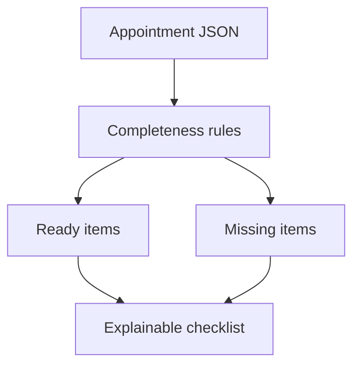

# Appointment Preparation Assistant

A local, non-clinical agent that turns user-entered appointment information into an explainable preparation checklist.

## How it works

The agent checks seven administrative fields: time, location, questions, medications, allergies, documents, and transport. It labels each field `ready` or `missing`, provides an action, and states which input caused the result.

## Architecture



## Flow

`User input → local validation → checklist items → evidence and disclaimer`

## Run and test

```bash
python app.py sample_data.json
python -m unittest -v
```

## Project structure

`app.py` contains the rules and CLI; `sample_data.json` is the demo input; `test_app.py` contains tests. The three OpenGAP passport files are in the root.

## Safety and limitations

This project does not diagnose, assess urgency, interpret symptoms, recommend treatment, or change medication. It uses no clinical database and cannot verify user-entered information.

## Passport

Publish as a separate GitHub repository, run `opengap validate`, and test at least one supported adapter export.
